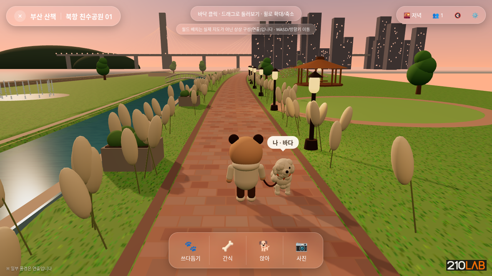
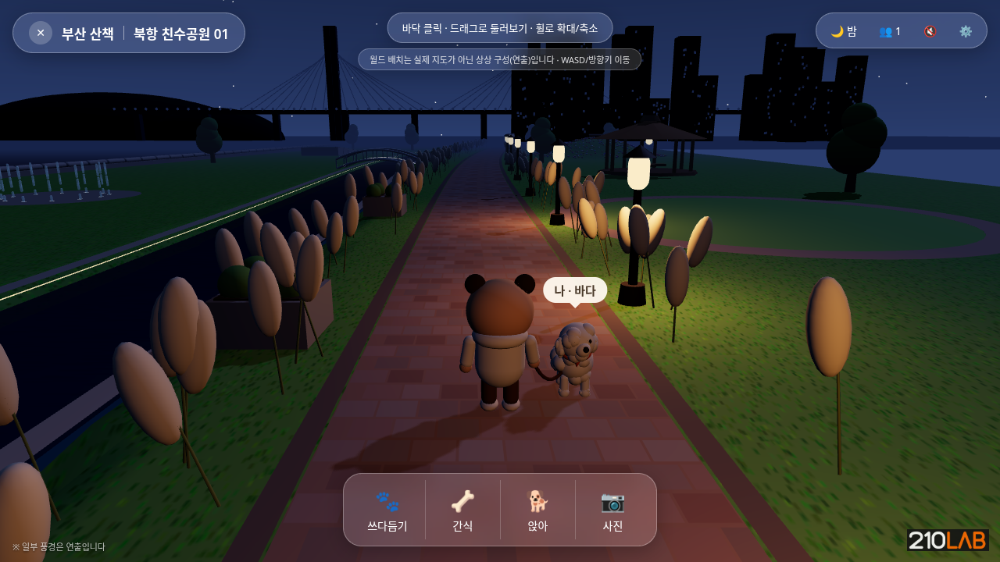

# 부산 산책 (Busan Walk) — 북항 친수공원

브라우저에서 바로 플레이하는 스타일라이즈드 3D 산책 게임 프로토타입입니다. 210LAB 제작.

- 플레이: https://hun0823.github.io/busan-walk/
- 조작: 바닥 클릭 / WASD·방향키 이동, 드래그 회전, 휠 확대·축소. 하단 버튼: 쓰다듬기·간식·앉아·사진. 시간대: 새벽·저녁·밤.

## 로컬 실행
```
python3 -m http.server 8080
# http://localhost:8080
```

## 참고
- 일부 풍경(배치, 건물, 다리 모양 등)은 실제 지도가 아닌 **연출**입니다.
- 산사(sansatemple.com)의 코드·모델·텍스처·음원은 사용하지 않았습니다. 에셋 출처는 ASSETS.md 참고.
- 모바일 실기기와 실제 GPU 성능은 아직 확인하지 않았습니다.



